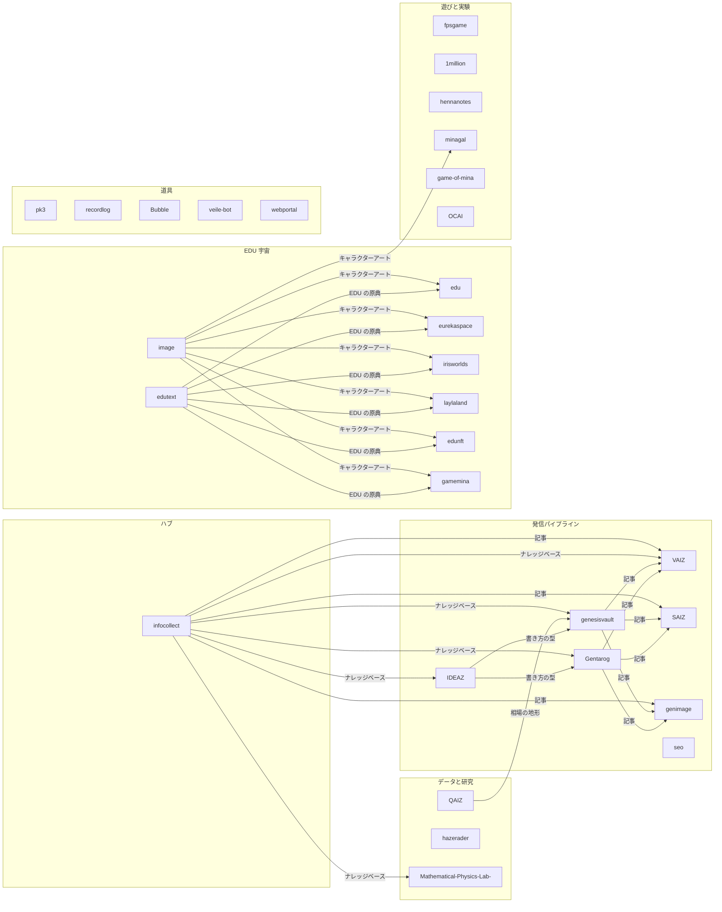

# gentaron のエコシステム

公開リポジトリ 58 本の地図。正本は [registry.json](./registry.json)。各リポジトリの「つながり」節と ecosystem.json はここから生成している（`node scripts/ecosystem/propagate.mjs`）。

## 流れ

## ハブ

集める・溜める・配る。ナレッジベース、AIハーネス、Forge

| リポジトリ | 役割 | 受け取る | 渡す |
| --- | --- | --- | --- |
| [infocollect](https://github.com/gentaron/infocollect) | 毎朝の AI 情報収集、ナレッジベース（RAG・MCP）、無料モデルの配車ハーネス、手元の AI 開発カンバン Forge |  | IDEAZ, genesisvault, Gentarog, VAIZ, Mathematical-Physics-Lab-, SAIZ, genimage |

## 発信パイプライン

題材を選び、書き、絵・スライド・動画にして出す

| リポジトリ | 役割 | 受け取る | 渡す |
| --- | --- | --- | --- |
| [IDEAZ](https://github.com/gentaron/IDEAZ) | 1日5枠のブログ・フォーマットと題材。コピーして AI に渡せば記事が立ち上がる | infocollect | genesisvault, Gentarog |
| [genesisvault](https://github.com/gentaron/genesisvault) | Mina Eureka Ernst の日記ブログ。12体のエージェント（Liminal Forge）が毎日書く | infocollect, IDEAZ, QAIZ | VAIZ, SAIZ, genimage |
| [Gentarog](https://github.com/gentaron/Gentarog) | 毎日自動で投稿されるブログ | infocollect, IDEAZ | VAIZ, SAIZ, genimage |
| [VAIZ](https://github.com/gentaron/VAIZ) | 完全無料の動画生成ループ。企画 → 画像 → 音声 → 動画 | infocollect, genesisvault, Gentarog |  |
| [SAIZ](https://github.com/gentaron/SAIZ) | テキストからスライドを作るツール | infocollect, genesisvault, Gentarog |  |
| [genimage](https://github.com/gentaron/genimage) | Eureka Thumb — 記事を貼るだけの文字サムネメーカー | infocollect, genesisvault, Gentarog |  |
| [seo](https://github.com/gentaron/seo) | Suggest Radar — 日本語検索のキーワード探索 |  |  |

## データと研究

毎日の計測と、検証できる研究

| リポジトリ | 役割 | 受け取る | 渡す |
| --- | --- | --- | --- |
| [QAIZ](https://github.com/gentaron/QAIZ) | 地域 × セクターの株式を一流の指標で横断分析するターミナル＋日本株クオンツ研究ラボ |  | genesisvault |
| [hazerader](https://github.com/gentaron/hazerader) | Cyberjaya の大気汚染指数（US AQI）を AI アンサンブルで毎日予測する PWA |  |  |
| [Mathematical-Physics-Lab-](https://github.com/gentaron/Mathematical-Physics-Lab-) | 無料の OSS で数理物理の構造を探索し、計算で候補を検証する研究ラボ | infocollect |  |

## EDU 宇宙

Eternal Dominion Universe。edutext が原典、ほかはその表現

| リポジトリ | 役割 | 受け取る | 渡す |
| --- | --- | --- | --- |
| [edutext](https://github.com/gentaron/edutext) | EDU の物語と設定の原典（テキスト） |  | edu, eurekaspace, irisworlds, laylaland, edunft, gamemina |
| [image](https://github.com/gentaron/image) | EDU のキャラクターアートの置き場（URL で参照される） |  | edu, eurekaspace, irisworlds, laylaland, edunft, gamemina, minagal |
| [edu](https://github.com/gentaron/edu) | EDU — E16 連星系を舞台とするオリジナル SF ユニバースの本体サイト | edutext, image |  |
| [eurekaspace](https://github.com/gentaron/eurekaspace) | EDU ユニバース百科事典 | edutext, image |  |
| [irisworlds](https://github.com/gentaron/irisworlds) | Iris（The Blue Phantom）のキャラクターサイト | edutext, image |  |
| [laylaland](https://github.com/gentaron/laylaland) | Layla Virel Nova（Pink Voltage）のファンサイト | edutext, image |  |
| [edunft](https://github.com/gentaron/edunft) | EDU の NFT カードのメタデータ | edutext, image |  |
| [gamemina](https://github.com/gentaron/gamemina) | GAMEMINA CHRONICLE — EDU をなぞる本格ファンタジー RPG（PWA・内蔵QA） | edutext, image |  |

## 遊びと実験

ゲーム・WebGL・ビューア

| リポジトリ | 役割 | 受け取る | 渡す |
| --- | --- | --- | --- |
| [fpsgame](https://github.com/gentaron/fpsgame) | Three.js / React Three Fiber の FPS |  |  |
| [1million](https://github.com/gentaron/1million) | 1億の観測者 — 1億体のエージェントが創発する世界を観測する WebGL2 |  |  |
| [hennanotes](https://github.com/gentaron/hennanotes) | 画像を自由にスライドできる PWA ビューア |  |  |
| [minagal](https://github.com/gentaron/minagal) | 青い髪のヒロインのイラストギャラリー | image |  |
| [game-of-mina](https://github.com/gentaron/game-of-mina) | キャラクターサイトの試作 |  |  |
| [OCAI](https://github.com/gentaron/OCAI) | 単一ページの実験 |  |  |

## 道具

単体で使える小さなアプリ

| リポジトリ | 役割 | 受け取る | 渡す |
| --- | --- | --- | --- |
| [pk3](https://github.com/gentaron/pk3) | StellarKnowledge — ローカルファーストのナレッジベース（サーバー不要） |  |  |
| [recordlog](https://github.com/gentaron/recordlog) | 話す → 文字になる → 1日1回 AI が整理して積む音声メモ |  |  |
| [Bubble](https://github.com/gentaron/Bubble) | project_aether の試作 |  |  |
| [veile-bot](https://github.com/gentaron/veile-bot) | Jupyter ノートブックのボット試作 |  |  |
| [webportal](https://github.com/gentaron/webportal) | React + Vite のポータル試作 |  |  |

## アーカイブ

試作・学習用。新しい作業は後継で

| リポジトリ | 役割 | 受け取る | 渡す |
| --- | --- | --- | --- |
| [presentationgen](https://github.com/gentaron/presentationgen) | PptxGenJS のプレゼン生成 | | 後継 → [SAIZ](https://github.com/gentaron/SAIZ) |
| [aiblogmaker](https://github.com/gentaron/aiblogmaker) | AI ブログ生成の試作 | | 後継 → [genesisvault](https://github.com/gentaron/genesisvault) |
| [nextjs-gens-notes](https://github.com/gentaron/nextjs-gens-notes) | Gens Notes（Next.js）の試作 | | 後継 → [genesisvault](https://github.com/gentaron/genesisvault) |
| [nextjs-gensnotes](https://github.com/gentaron/nextjs-gensnotes) | Gens Notes の Sanity スタジオ | | 後継 → [genesisvault](https://github.com/gentaron/genesisvault) |
| [gensnotes](https://github.com/gentaron/gensnotes) | Gens Notes の初期版 | | 後継 → [genesisvault](https://github.com/gentaron/genesisvault) |
| [genesisone](https://github.com/gentaron/genesisone) | Genesis の初期ページ | | 後継 → [genesisvault](https://github.com/gentaron/genesisvault) |
| [image-manage](https://github.com/gentaron/image-manage) | AI タグ付きの画像管理 | | 後継 → [image](https://github.com/gentaron/image) |
| [dreamy-image-gallery-paradise](https://github.com/gentaron/dreamy-image-gallery-paradise) | 画像ギャラリー（Lovable） | | 後継 → [minagal](https://github.com/gentaron/minagal) |
| [imgprompt](https://github.com/gentaron/imgprompt) | 画像プロンプトの試作 | | 後継 → [genimage](https://github.com/gentaron/genimage) |
| [game3d](https://github.com/gentaron/game3d) | Three.js の 3D FPS（初期版） | | 後継 → [fpsgame](https://github.com/gentaron/fpsgame) |
| [hentaigame](https://github.com/gentaron/hentaigame) | Rhythm Rush — 背景が変わるリズムゲーム | | 後継 → [hennanotes](https://github.com/gentaron/hennanotes) |
| [sakuranovel](https://github.com/gentaron/sakuranovel) | Web 小説アプリ（sakura.txt から生成） | | 後継 → [edutext](https://github.com/gentaron/edutext) |
| [yelanwiki](https://github.com/gentaron/yelanwiki) | Wiki の試作 | | 後継 → [eurekaspace](https://github.com/gentaron/eurekaspace) |
| [nebura](https://github.com/gentaron/nebura) | 単一ページの試作 | |  |
| [neburas](https://github.com/gentaron/neburas) | nebura の Vite 版 | |  |
| [newnebura](https://github.com/gentaron/newnebura) | nebura の作り直し | |  |
| [aieducate](https://github.com/gentaron/aieducate) | React + TypeScript の学習用 | |  |
| [qrtng](https://github.com/gentaron/qrtng) | React + Vite の試作 | |  |
| [CryptoMemeCoin](https://github.com/gentaron/CryptoMemeCoin) | ミームコインのページ試作 | | 後継 → [edunft](https://github.com/gentaron/edunft) |
| [calculator](https://github.com/gentaron/calculator) | 電卓 | |  |
| [first-app](https://github.com/gentaron/first-app) | 最初のアプリ | |  |
| [nandl](https://github.com/gentaron/nandl) | 単一ページの試作 | |  |
| [vercel](https://github.com/gentaron/vercel) | Vercel の試作 | |  |
| [openfg](https://github.com/gentaron/openfg) | 試作 | |  |
| [windsurf](https://github.com/gentaron/windsurf) | Windsurf の試作 | |  |
| [project-ant](https://github.com/gentaron/project-ant) | 試作 | |  |
| [intro-html](https://github.com/gentaron/intro-html) | GitHub Learning Lab（HTML 入門） | |  |
| [github-slideshow](https://github.com/gentaron/github-slideshow) | GitHub Learning Lab（GitHub 入門） | |  |

## 全リポジトリ共通の道具

- **ナレッジベース**（MCP `infocollect-kb`）: 調べ物はまずここ。各リポジトリの役割もここに入っている
- **Forge**（MCP `forge`）: 大きな作業をカードに割って無料のエージェントへ。マージは人
- **AGENTS.md の「エコシステム」節**: AI が作業前に読む、そのリポジトリの上流・下流
